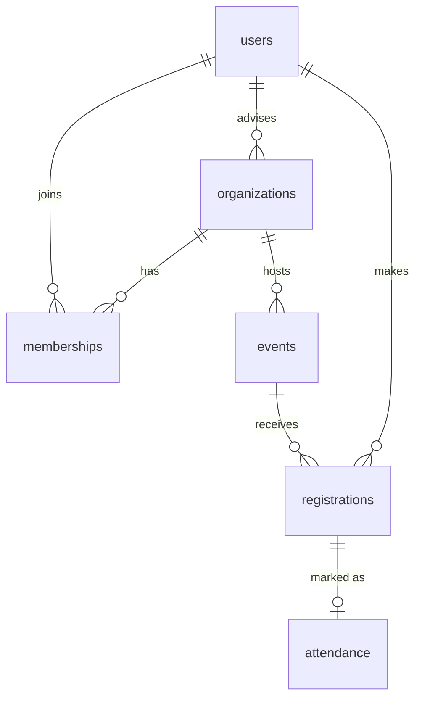

# SORERS: Student Organization Management and Event Registration System

A working implementation of the Group 6 thesis proposal (ICCT Cainta). Stack follows the proposal's proposed list: **PHP + MySQL + HTML/CSS/JavaScript**, runs on XAMPP. No framework or Composer packages are needed.

## Run it on XAMPP (MySQL)

1. Copy this folder to `C:\xampp\htdocs\sorers` and start **Apache** and **MySQL** in the XAMPP control panel.
2. Open a terminal in the folder and run `C:\xampp\php\php.exe setup.php --demo`
   (use `setup.php` without `--demo` for an empty system with just an admin account; the password is printed once).
3. Open `http://localhost/sorers/public/`.

If your MySQL has a root password or a different host, edit `config.php` or set the `DB_HOST`, `DB_USER`, `DB_PASS`, `DB_NAME` environment variables.
Re-run with `--fresh` to wipe and rebuild.

### Quick try without MySQL
`DB_DRIVER=sqlite php setup.php --demo && DB_DRIVER=sqlite php -S localhost:8000 -t public` (needs PHP's `pdo_sqlite`).

## Demo accounts (password `Password123!` for all)

| Role | Login |
|---|---|
| System administrator | admin@icct.test |
| Student affairs staff | staff@icct.test |
| Organization adviser | adviser1@icct.test (JPCS), adviser2@icct.test (BAS) |
| Organization officer | student1@icct.test (JPCS president), student5@icct.test (BAS president) |
| Student | student3@icct.test and others (student2 … student8) |

Demo data includes two organizations, an event that is full, a past event with attendance, a draft, and a pending join request. **Delete the demo accounts before any real use.**

## What each role can do (from slide 7 and 13 of the proposal)

| | Student | Officer | Adviser | Staff | Admin |
|---|:-:|:-:|:-:|:-:|:-:|
| Create own account, log in/out | ✓ | ✓ | ✓ | ✓ | ✓ |
| Browse events and organizations | ✓ | ✓ | ✓ | ✓ | ✓ |
| Request to join / leave an organization | ✓ | ✓ | | | |
| Register for / cancel an event | ✓ | ✓ | | | |
| See own memberships, registrations, attendance | ✓ | ✓ | | | |
| Add, approve, update, remove members and positions | | own org | | | all |
| Create, edit, publish, cancel events | | own org | | | all |
| See registrants, mark attendance, export CSV | | own org | view own orgs | view all | all |
| Reports across organizations | | | own orgs | all | all |
| Manage users, roles, organizations, advisers | | | | | ✓ |

## Rules enforced by the system

- Registration is blocked when the event is a draft, cancelled, ended, past its deadline, full, or the student is already registered (also enforced by a database unique key).
- The participant limit is re-checked inside a transaction, so two simultaneous sign-ups cannot exceed it.
- Cancelling a registration is allowed until the event starts; it also clears any attendance mark.
- Marking someone as an officer of an organization promotes the account to the officer role; removing the last officer position demotes it back to student.
- Member lists, registrant lists and CSV exports are visible only to that organization's officers and adviser, student affairs staff and admins.

## Security and privacy (non-functional requirements)

Passwords hashed with `password_hash`; all SQL uses prepared statements; all output is HTML-escaped; CSRF token on every form; session ID regenerated at login; deactivated accounts lose their live session; CSV cells starting with `= + - @` are neutralized; only name, student number, course and email are collected (RA 10173).

## Structure

```
config.php            database and app settings
setup.php             creates tables, admin, optional demo data
database/schema.sql   six tables (see ERD)
app/                  lib.php (data + rules), layout.php, bootstrap.php
public/               one PHP page per screen, assets/style.css
tests/smoke.sh        53 end-to-end checks across all five roles
```

Point Apache at `public/` for deployment so `app/`, `config.php` and `setup.php` are not web-reachable.

## ERD



## Things the proposal left open (decisions I made, easy to change)

- **Who approves what.** The proposal says approvals are "to be confirmed with the adviser and student affairs office". I made officers approve join requests and publish their own events, with no staff or adviser sign-off step. If an approval step is required, it fits on `events.status` and `memberships.status`.
- **Officers are per organization**, so an officer of one organization has no rights in another.
- **Registration is open to any student**, not only members of the hosting organization.
- Framework: plain PHP was used instead of Laravel to keep it runnable on XAMPP without Composer. The proposal says the framework is not final.
- Out of scope per slide 6: payments, voting, biometrics, AI, notifications, mobile app.

## Known limits

- Tested here on PHP 8.3 with SQLite. The MySQL schema and queries use portable SQL, but I had no MySQL server to run it against, so run `tests/smoke.sh` after your first XAMPP setup.
- No password-reset-by-email or login rate limiting; admins reset passwords from the Users page.
- No scheduled database backup (proposal says "regular backups"); use XAMPP's `mysqldump` on a schedule.
